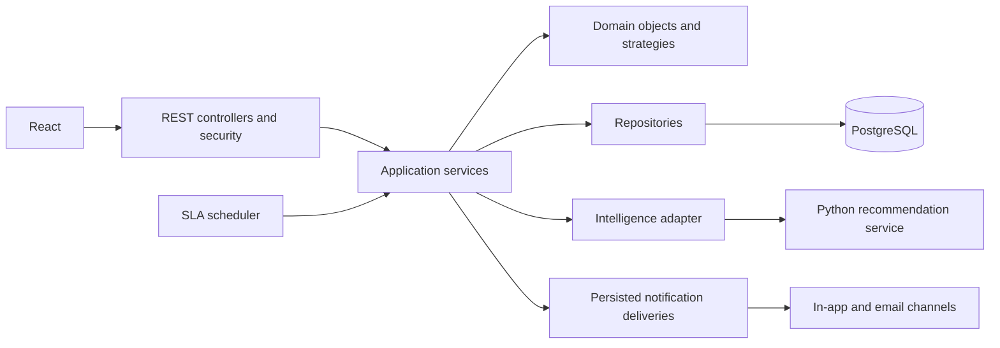
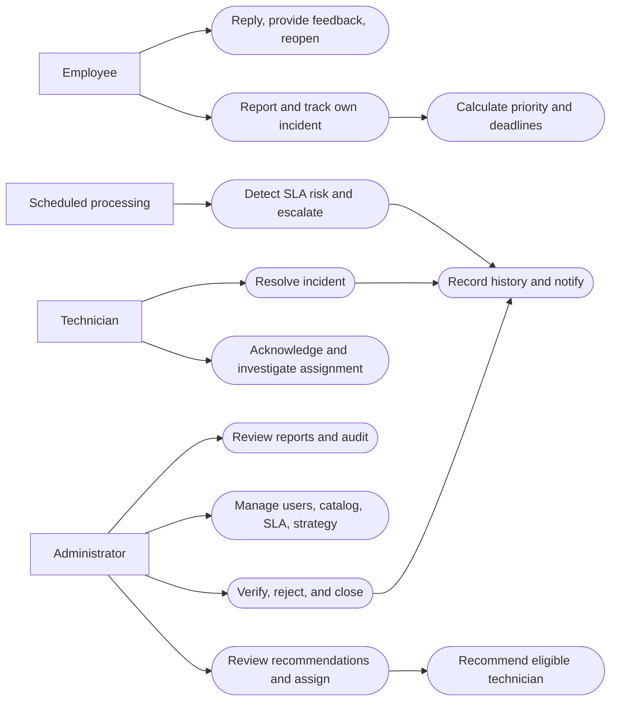
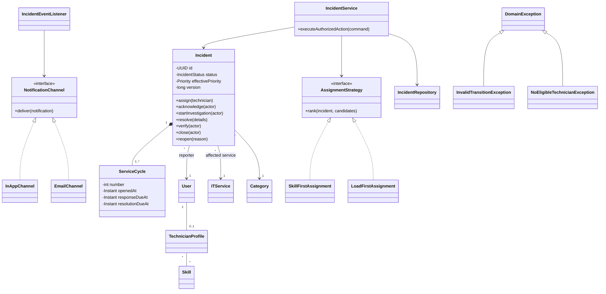
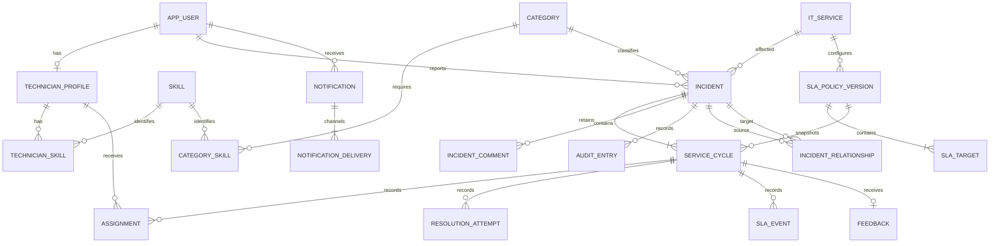

# Domain and database design

This is a conceptual design, not migration SQL. Field constraints and lengths below are proposed defaults. IDs are UUIDs, timestamps are UTC instants stored as timezone-aware timestamps, and referenced records are deactivated rather than cascade-deleted.

## Architecture

## Use-case sketch

The following actor/use-case map is an initial sketch for the report's final UML use-case diagram.

## Class sketch

Application services enforce authorization and transactions; domain objects protect state invariants. Strategy demonstrates interchangeability. Event listeners demonstrate Observer-style notification delivery; audit entries are written inside the original transaction. Exceptions provide a justified inheritance relationship. Do not add inheritance purely to make the diagram larger.

## ER sketch

## Data dictionary

| Record | Important fields and rules |
|---|---|
| app_user | id, display_name, normalized_email (unique), password_hash, role, active, created_at. Never return hash. |
| technician_profile | user_id (PK/FK), available, capacity (positive), experience_months (nonnegative). Workload is derived, not an independently editable counter. |
| skill | id, name (unique), active. |
| technician_skill | technician_id + skill_id (composite unique), level (proposed 1–5). |
| category | id, name (unique), active. Configurable records rather than Java enum. |
| category_skill | category_id + skill_id (unique), minimum_level. Proposed all listed requirements must be met. |
| it_service | id, name, description, criticality (proposed 1–3), active. |
| sla_policy_version | id, service_id, version, effective_at, active. Published versions immutable; one current version per service. |
| sla_target | policy_version_id + priority (unique), response_seconds, resolution_seconds (positive). Four priority rows per published policy. |
| incident | id, reference (unique readable code), reporter_id, service_id, category_id, title (1–200), description (1–10000), impact, urgency, affected_user_count (optional positive), status, calculated_priority, effective_priority, override_reason, priority_input_snapshot, rule_version, current_cycle_number, created_at, updated_at, version. |
| service_cycle | id, incident_id + number (unique), opened_at, policy_version_id, target/deadline snapshots, deadline_revision, first_acknowledged_at, effective_resolved_at, verified_at/by, closed_at/by, closure_note, reopen_reason. First cycle begins at incident creation. |
| assignment | id, cycle_id, technician_id, assigned_by, strategy or MANUAL, reason, assigned_at, ended_at. At most one active assignment per cycle. |
| resolution_attempt | id, cycle_id, technician_id, details, resolved_at, outcome (pending/accepted/rejected), reviewed_by/at, review_note. Preserve rejected attempts. |
| incident_comment | id, incident_id, author_id, body, kind (NOTE/INFORMATION_REQUEST/REPLY), visibility (PUBLIC/INTERNAL), reply_to_id optional, created_at. Referenced reply must belong to same incident. |
| audit_entry | id, incident_id, cycle_id optional, actor_id nullable for system, actor_type, action, previous/new values, description, timestamp. Append-only through application API. Redact internal fields for employee timeline. |
| sla_event | id, cycle_id, target (RESPONSE/RESOLUTION), event_type (WARNING/VIOLATION/ESCALATION), deadline_revision, occurred_at, detected_at. Composite uniqueness suppresses repeats. |
| notification | id, recipient_id, incident_id optional, event_key, safe message, created_at, read_at. |
| notification_delivery | id, notification_id, channel, delivery_status, attempts, next_attempt_at, delivered_at. Unique notification/channel; retries must not create new notifications. |
| feedback | id, cycle_id (unique), reporter_id, rating (1–5), text optional, created_at. Only incident reporter may submit. |
| incident_relationship | id, source_id, target_id, type (DUPLICATE/RELATED), confirmed_by/at. No self-link; enforce canonical ordering and uniqueness for symmetric RELATED links. DUPLICATE is directional. Avoid duplicate-link cycles. |

Actor references are foreign keys even where not drawn in the compact ER sketch. Active-assignment and current-cycle consistency require transaction checks in addition to constraints. Incident version protects conflicting updates; assignment capacity needs serialized eligibility checking for the selected technician.

Proposed indexes: incident reporter/created_at, status/priority, service/created_at, category, assignment technician/ended_at, current cycle deadlines, audit incident/timestamp, and notification recipient/read_at. Validate actual query needs before finalizing migrations.

No destructive cascade from users/services/categories to incidents. Archival is a visibility decision; closure is a business milestone. Database transactions include both the state change and audit record, plus pending notifications where required.
